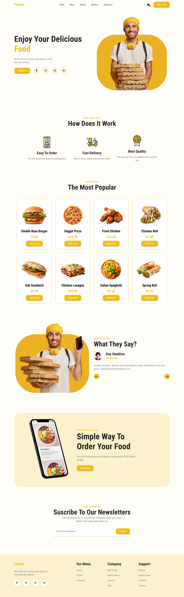

# Foodie - Food Delivery Website

A responsive food delivery website built with HTML, CSS, and vanilla JavaScript. Product information is loaded from `products.json`.

## Features

- Responsive navigation and page layout
- Menu cards generated from product data
- Cart panel with quantity controls and total price
- Customer review carousel powered by Swiper
- Service, app, newsletter, and footer sections

The newsletter section is presentation-only; it is not connected to a mailing service or backend.

## Screenshots

### Desktop



## Run Locally

This project has no build step or package installation. Serve the project over HTTP so the browser can fetch `products.json`.

### VS Code Live Server

1. Install the **Live Server** extension in VS Code.
2. Open `index.html` and select **Open with Live Server**.

### Command line

With Node.js installed, run this from the project directory:

```powershell
npx --yes http-server . -p 5501
```

Then open `http://localhost:5501` in your browser. The command may download `http-server` the first time, so it requires an internet connection.

## Project Files

- `index.html` - page structure and script/style references
- `styles.css` - layout, responsive styles, and component styling
- `script.js` - menu rendering, cart interactions, and navigation behavior
- `scriptPractiseSelf.js` - alternate practice script; not loaded by `index.html`
- `products.json` - product names, prices, IDs, and image paths
- `images/` - food, profile, and app illustrations

## Acknowledgment

I built this website as a learning project while following [this YouTube tutorial](https://www.youtube.com/watch?v=RUG8yFJKVco&t=14374s).
